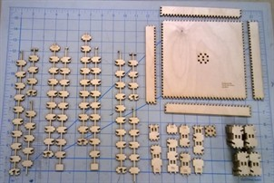
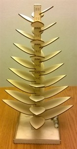
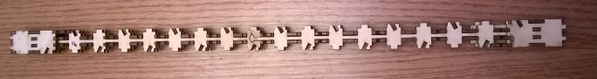

# Laser-Cut Marble Tree

I had seen marble trees for the first time many years ago at a friend’s
house. I immediately decided to build one at home with a table saw and a scroll
saw. In fact, I built several of these for various nieces and nephews (our own
kids were already out of the prime age). Several years later I got access to a
laser cutter and started to wonder if you could build one using ONLY a laser
cutter. Obviously, you can easily cut the leaves and the base with a laser
cutter, but the trunk was a challenge. After some thought I decided it was
possible by having a central ‘spine’ on which ‘tiles’ could be hung. Here you
see all the pieces after laser cutting but before assembly.

| Pieces after laser cutting | Finished marble tree |
|:---:|:---:|
|  |  |

The long pieces on the left of that photo interlock with each other and give the
center stalk its strength. The photo on the right is the finished tree. There
are over 40 tiles that are ‘hung’ on the spine to simulate a solid center stalk
with groves that are cut into the faces at a compound angle (tipping each leaf
up but also tilted so a marble on the leaf will want to roll around the stalk).
The fact that you could make this using a laser cutter (that only can cut thin
material and only at 90 degrees), is very surprising (at least to me).

The result is quite attractive. The central spine does show through as small
boxes at the center of each tile, and the burnt edges left by the laser cutter
give it a rustic vibe.

The result is quite unique and is a wonderful gift for children of all ages
(including some decades old like myself).