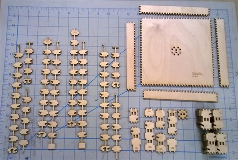

# Result of the Laser Cutting

When you are done laser cutting you should have all the pieces as shown in the
photo below.

In particular you should have

- A Base, and 4 sides. If you look closely one set of sides (top and bottom) are
  identical and the other set (left and right) are identical.
- A set of 10 ‘spines’ pieces. They are grouped together above in the way they
  will be assembled (thus the left and right pieces have 3 parts, and the front
  and back have 2).
- A set of 8 ‘top and bottom’ shingle pieces. These are shown in the lower
  center in the image above. They are all labeled and it is a good idea to
  arrange them as shown (labels up). Notice that the ‘three prong ends mate with
  the ‘interior’ of the trunk, and the ‘two prong’ ends are the extreme top or
  bottom of the trunk.
- One ‘top piece’. This is the small square piece with two holes in it next to
  the pile of trunk pieces and forms the top of the trunk.
- 32 identical ‘shingles’. These form the outside of the trunk
- 4 sets of 9 leaves for a total of 36 leaves (not shown).
