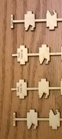
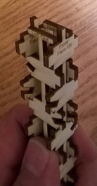

# Assembling the 4 Spines into the Trunk Core

Now we have four spines (left, right, front back, which are all the same length.
We now need to form the ‘core’ of the trunk.

This is the most critical part, and it is easy to get it wrong. Follow the
instructions carefully.

Arrange them as left, back, right as shown here

Next place the top piece on top of the bottom piece (thus the lettering on both
pieces face up), and then place the left piece on the left (LETTERING OUT (TO
THE LEFT), and the right piece on the right (LETTERING IN (TO THE LEFT). If you
do this properly you should look like this (expanded so you a read the
lettering)

