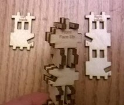
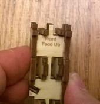
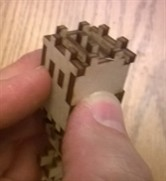
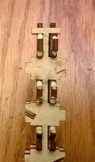
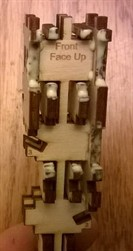
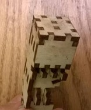

# Attaching the Top Shingles

Next we dry fit the top shingles. Start with the left and right top shingles as
shown below.

Then attach the left size to the core (LETTERING IN), and the right to the right
side (LETTERING IN). It should go on easily as shown below

Repeat the process for the front and back pieces. Again the lettering FACES
INSIDE. All the pieces should go together easily and the result should look like
this looking down from the top.

Now we are ready to glue the top pieces together. We will take of the shingles
and then put them on again, this time with glue. Basically any place where the
shingle and the core touch, you should put dabs of glue. I put the dabs on the
core pieces as shown below, but feel free to do it however you like, as long as
all joints gets glue.

After you have glued on the left and the right piece, you can do the same for
the front and back. This image shows the dabs of glue just before the front
piece is attached with glue.

Once you have the top shingles installed around the core, you can put on the top
piece. Again dab glue on all places where two pieces touch. The result should
look like this.

