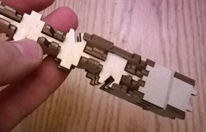
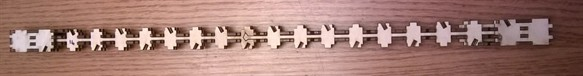

# Glue the Bottom Shingles to the Central Core

Gluing the bottom shingles works exactly like the top shingles. Just make sure
you orient them properly ALL LETTERING FACES IN, and of course should go in
their labeled place. If you do this right, the longest bottom shingle is on the
same face as the shortest top shingle and vise versa. As before dry-fit the
pieces and then disassemble and reassemble with glue. After doing this gluing
the bottom shingles the trunk will look like this.

And the trunk as a whole will look like this

