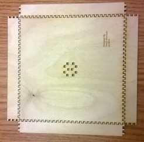
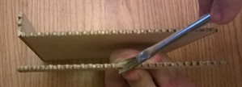
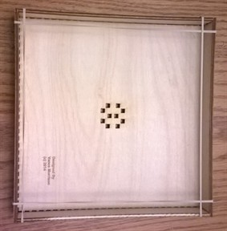

# Assembling the Bottom Tray

## Sand the pieces!

Once the tray is assembled it is difficult to sand the interior. Thus you want
to sand all the pieces of the tray BEFORE you assemble it so that they look nice
and feel smooth.

## Orient the pieces

Now that the trunk is done, you can assemble the bottom tray. First arrange the
pieces as show below (notice how the pieces interlock). The top and bottom are
identical (but turned end-for-end), and simmilarly the left and right pieces are
identical (and turned end-for-end).

You can then start applying gue to the bottom piece and one of the sides. Be
sure to get a good coat of glue to all touching surfaces (A brush is highly
recommended, you don’t want dry joints), but because you can’t sand the inside
easily, you should avoid excessive glue that will squirt out.

Again, because you can’t and the inside, you will probably want to wipe the
inside with a very damp paper towel to remove any excess glue, so it does not
discolor the wood after it dries.

Finally rubber bands are very useful for holding the tray sides together as the
glue dries. What I did while assembling is glue one edge then dry-fit the other
sides and use rubber bands until the first side dries. Then do the next. The
last two can usually be glued at the same time.

