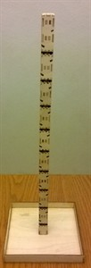

# Attach the Trunk to the Tray

Once the tray is complete, you can go ahead and glue the finish (and sanded)
trunk to the finished tray. It is usually best if you clamp the trunk upside
down (or put it between two couch cushions), while the glue dries so that the
trunk dries straight up and down. The result is shown below.

