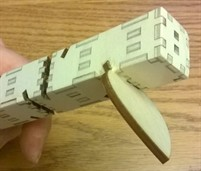
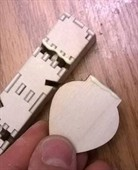
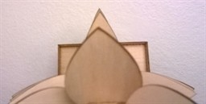

# Glue in the Leaves

After the trunk / Tray is assembled there is only one final step, gluing in the
leaves. Ideally these dry-fit snugly (you in fact scaled the drawing precisely
so this would happen).

To start the gluing you can start with the smallest 4 leaves and run a thin bead
of glue along BOTH sides at the bottom as well as the bottom edit. Also run some
glue in the channel in the trunk and ideally use a brush to spread the glue
evenly. You should use some care to use just the right amount of glue and
because from here on any glue that oozes out will probably stain some visible
wood that will be hard to sand. Thus do use come care.

Once you have done the smallest leaf, glue in the leaves starting with the
biggest. As you do so you should be sighting down from the top to insure that
all the leaves tips form a straight line. This insures that you are seating each
leave well and none of them are askew.

